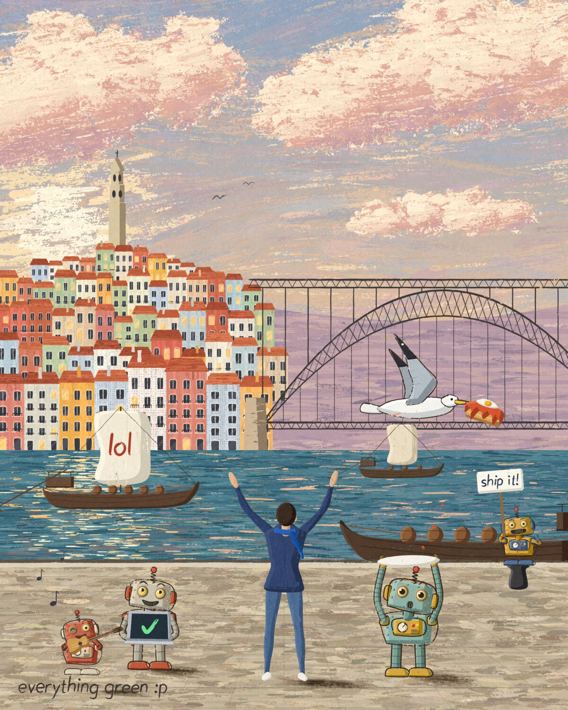
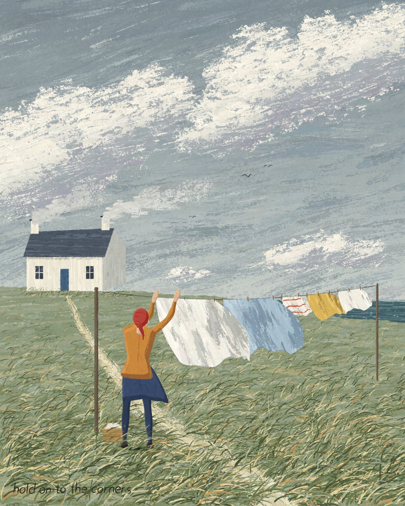

# 🎨 painterly

> Paint gouache-style illustrations in TypeScript: dry brush strokes, paper grain, hand-lettered captions, all generated in code.

Most generative art looks generated. painterly copies how real paint behaves instead: a brush that runs dry along the stroke, bristle streaks, paper tooth showing through, flat shapes with a shadow side. Each illustration is one TypeScript file that paints back to front, like a person would. No image textures or traced references, only code.

<p>
  
  
</p>

## ✨ Features

- 🖌️ **A real brush model.** Every mark is a stroke with bristle streaks and paint load; low load gives broken, dry-brush edges.
- 📄 **Paper tooth.** A seeded grain texture shared by every stroke, so layers sit on the same paper.
- ☁️ **Ready-made motifs.** Skies, clouds, sea and river reflections, grass, paths, cottages, townhouses, bridges, boats, laundry, gulls.
- 🧍 **Posable figures.** A 7-head body with tapered limbs and form shading, posed by joint angles.
- 🤖 **Tin robots.** Riveted, scuffed, hatched and inked, with expressions.
- ✍️ **Hand lettering.** Captions and signs painted as brush handwriting.
- 🎲 **Seeded.** Same seed, same painting; change it for fresh brushwork.

## 🧰 Built with

[TypeScript](https://www.typescriptlang.org) · [Node.js](https://nodejs.org) · [@napi-rs/canvas](https://github.com/Brooooooklyn/canvas) (shape masks and PNG output)

## 🚀 Install in 3 steps

**You need:** Node.js 24 or newer (it runs `.ts` files directly) and pnpm.

**1. Clone and install**

```sh
git clone https://github.com/nikuscs/painterly.git
cd painterly
pnpm install
```

**2. Paint a scene**

```sh
node render.ts scenes/porto-golden-hour.ts
```

Writes `out/porto-golden-hour.png` at 1600 × 2000 in about 10 seconds.

**3. Repaint it with different brushwork**

```sh
node render.ts scenes/laundry-day.ts --seed 4 --out out/laundry-4.png
```

## 🖼️ Write your own scene

A scene exports its size, seed, paper colour and a `draw` function. Paint back to front: sky, clouds, distance, ground, subjects, foreground, caption, then `finish()`.

```ts
import { handwrite } from '../src/hand.ts'
import { cloud, sky } from '../src/motifs/sky.ts'
import type { Scene } from '../src/scene.ts'

export default {
  width: 1200,
  height: 1500,
  seed: 1,
  paper: '#f2eee4',
  draw(p) {
    sky(p, {
      horizon: 1400,
      wind: -0.2,
      top: '#7f8d90',
      bottom: '#c9cfc8',
      strokes: ['#8796a0', '#93a1a6'],
      highlights: ['#aab6b8', '#c0c6c1'],
    })
    cloud(p, {
      spine: [[200, 600], [500, 450], [800, 380]],
      radius: [120, 160, 110],
      lumps: 8,
      base: 660,
      light: '#f5f0e2',
      shadow: '#a7aeb2',
      deep: '#a39caa',
      sky: '#97a4a9',
      wind: -0.2,
    })
    handwrite(p, 'a quiet sky', 40, 1450, { size: 42 })
    p.finish()
  },
} satisfies Scene
```

## 🧱 How it fits together

| Layer | File | What it gives you |
| --- | --- | --- |
| Brush | `src/painter.ts` | `stroke`, `line`, masks (`mask`, `polygon`, `blob`, `tube`), `fill`, form-shaded `shape`, `rim`, `finish`, `save` |
| Noise | `src/noise.ts` | Seeded simplex noise and tileable grain textures |
| Brushwork | `src/brushwork.ts` | `scumble` (loose strokes over a region) and `hatch` |
| Motifs | `src/motifs/` | Sky, water, land, buildings, boats, figures, robots, critters and props |
| Lettering | `src/hand.ts` | `handwrite` for captions and signs |
| Scenes | `scenes/` | One file per illustration |

> [!TIP]
> Keep a palette muted and close in value, and let `load` do the work: around 0.9 for solid paint, 0.3 to 0.5 for dry, broken edges.

## 📄 License

MIT
